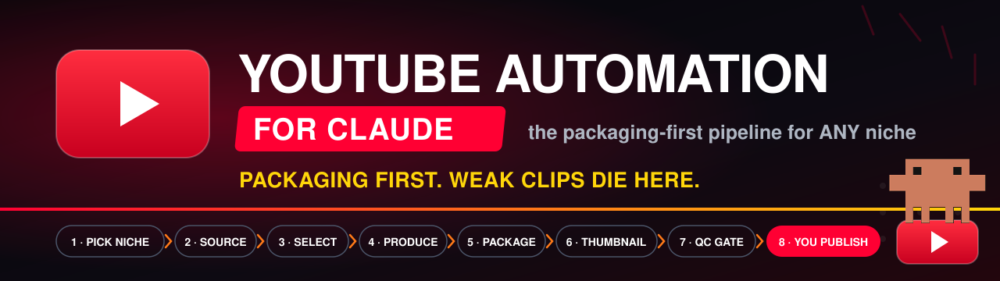
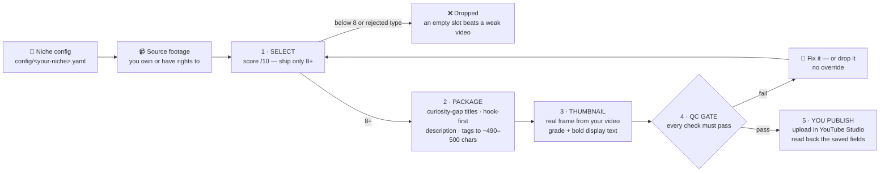

<p align="center">
  
</p>

<p align="center">
  <a href="LICENSE"></a>
  
  
  
  
  
</p>

<h1 align="center">YouTube Automation for Muse</h1>

<p align="center">
  <strong>Videos don't fail because they're bad — they fail on packaging.</strong><br>
  A packaging-first YouTube pipeline for <strong>any niche</strong>: winner-only moment selection,
  full SEO packs, thumbnails built from real frames, and a QC gate that refuses to ship weak work.
</p>

---

## What this is

This repo is a complete, niche-agnostic YouTube system you can hand to
your AI agent (Meta Muse, or any agent that reads skill files) — or
run yourself from Python. It encodes one hard-won lesson: **title,
thumbnail, and the first seconds decide whether anyone ever sees the
content.** So the pipeline designs the packaging *first*, only makes
moments that match proven winning patterns, and refuses to ship
anything that fails its QC gate.

You bring a niche and footage you own or have the rights to use. The
pipeline handles selection, packaging, thumbnails, and QC. Publishing
stays a deliberate human step in YouTube Studio, verified by
read-back.

## Quickstart

```bash
git clone https://github.com/EdgeAgent/youtube-automation-claude.git
cd youtube-automation-claude
./setup.sh
```

Then pick your path — full details in [INSTALL.md](INSTALL.md):

- **With an agent (recommended):** point it at [`SKILL.md`](SKILL.md),
  say your niche, and it sets everything up with you.
- **By hand:** copy `config/niche.example.yaml` to
  `config/<your-niche>.yaml`, fill it in, and drive the modules in
  `pipeline/` from Python.

## Workflow map



## The five stages

1. **Select** (`pipeline/select.py`) — candidate moments are scored on
   five questions (0–2 each, /10): winning moment type, hook in the
   first frame, title curiosity without spoiling, would a stranger
   finish it, better than the channel average. Ship only at 8+.
   Dead categories (menus, filler, no-payoff beats) are hard-rejected.
   *An empty slot beats a weak video.*
2. **Package** (`pipeline/seo.py`) — a full metadata pack per video:
   curiosity-gap title options, a description that opens with a hook
   line and a subscribe line (then body, steps for how-to/secret
   videos, source credit, disclaimer, hashtags), and tags filled to
   ~490–500 characters — video-specific first, niche canonical set
   after, generics trimmed from the end.
3. **Thumbnail** (`pipeline/thumbnail.py`) — a **real frame** from
   your own video, pulled with ffmpeg, given a saturated grade and
   bold outlined display text. Text is checked against a safe zone
   and for legibility at feed size. No AI key art, no stock photos.
4. **QC** (`pipeline/qc.py`) — the pre-publish gate. Score, title,
   description structure, tag fill, thumbnail checks: **every check
   must pass**, or the item is fixed or dropped. No override.
5. **Publish** — a human step, on purpose. You upload in YouTube
   Studio with the pack beside you, then read back the saved fields
   to confirm they match. (See `SKILL.md`, step 5.)

## What's in the repo

| Path | What it is |
|---|---|
| [`SKILL.md`](SKILL.md) + [`skill.yaml`](skill.yaml) | The agent skill — hand the repo to your Muse and it runs the whole pipeline with you |
| [`INSTALL.md`](INSTALL.md) | Both install paths: agent route and plain CLI route |
| [`setup.sh`](setup.sh) | One-command environment check (Python 3.10+, Pillow, ffmpeg) |
| [`pipeline/select.py`](pipeline/select.py) | Winner picker — scores candidate moments /10, ships only 8+ |
| [`pipeline/seo.py`](pipeline/seo.py) | SEO pack builder — titles, hook-first descriptions, tags filled to ~490–500 chars |
| [`pipeline/thumbnail.py`](pipeline/thumbnail.py) | Thumbnail builder — real frames, grade + display text, safe-zone checks |
| [`pipeline/qc.py`](pipeline/qc.py) | Pre-publish QC gate — every check must pass, no override |
| [`pipeline/config.py`](pipeline/config.py) | Stdlib-only niche config loader |
| [`config/niche.example.yaml`](config/niche.example.yaml) | The niche template — copy it, fill it in, the pipeline reads it at every stage |
| [`config/examples/`](config/examples/) | Three worked niche configs (see below) |
| [`docs/packaging-playbook.md`](docs/packaging-playbook.md) | The strategy the code enforces: packaging first, APV/AVD/impressions, outlier theory, title craft |
| [`docs/channel-optimization.md`](docs/channel-optimization.md) | Channel-level checklist: description formula, channel keywords, per-video audit |
| [`tests/`](tests/) | Pytest suite (24 tests) covering scoring, tag filling, description structure, thumbnail layout, the QC gate, and config loading |
| [`CHANGELOG.md`](CHANGELOG.md) | Release history — currently v0.1.0 |

## Pick any niche

The niche is just a config file. `config/niche.example.yaml` is the
template; `config/examples/` ships three worked examples:

- **Gaming clips** (`gaming-clips.yaml`) — fails, funny moments,
  reactions, secrets
- **Bodycam / public footage** (`bodycam-public-footage.yaml`) —
  chases, takedowns, K9 tracks (publicly released footage only; blur
  bystanders, plates, minors)
- **Faceless facts** (`faceless-facts.yaml`) — countdowns,
  myth-busting, shocking facts

Your niche can be anything else: cooking disasters, woodworking
saves, kayak fishing, local history — if it has moments, it fits.

## Install

**Route A — Claude skill (recommended).** Clone the repo, open your
agent in the repo folder, point it at `SKILL.md`, and say your niche.
The agent runs `./setup.sh`, builds your niche config with you
(studying the top videos in your niche for the canonical tag set),
then runs the pipeline video by video. You do the final upload.

**Route B — plain, no agent.** `./setup.sh`, copy the config
template, `pip install Pillow pytest`, and drive the modules from
Python:

```python
from pipeline.config import load_niche_config
from pipeline.select import MomentCandidate, score_candidate
from pipeline.seo import build_pack
from pipeline.thumbnail import extract_frame, build_thumbnail
from pipeline.qc import run_qc

niche = load_niche_config("config/my-niche.yaml")
# ...score moments, build the pack, build the thumbnail, run QC.
# Publish by hand in YouTube Studio — see SKILL.md, step 5.
```

Full walkthrough for both routes: [INSTALL.md](INSTALL.md).

## Requirements

- A YouTube channel (yours).
- Footage you **own or have the rights to use**, and your own way of
  getting it into YouTube Studio (browser is fine).
- Python 3.10+, Pillow, ffmpeg. Nothing else. (pytest is optional,
  for the test suite: `python3 -m pytest`.)

## Honest limits

- **Copyright & reused content.** YouTube's reused-content policy is
  real and it ends channels. Use footage you own or have rights to,
  transform it with your own commentary/value, and credit sources.
  This repo does not make other people's footage safe to repost.
- **No guarantees.** These are patterns that correlate with outlier
  videos, drawn from studying what wins. They do not guarantee views,
  subscribers, or monetization — anyone who promises that is selling
  something.
- **No upload automation.** Nothing here logs into your account or
  posts for you. Publishing stays human, verified by read-back.

## License

MIT — see [LICENSE](LICENSE).

## Credits

The packaging system is inspired by the Decoded Genius / Jake Bryant
packaging playbook (packaging first, outlier theory, upload less) and
by outlier research across top clip channels, generalized here for
any niche. Built by Edge Agency.
