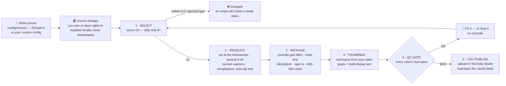
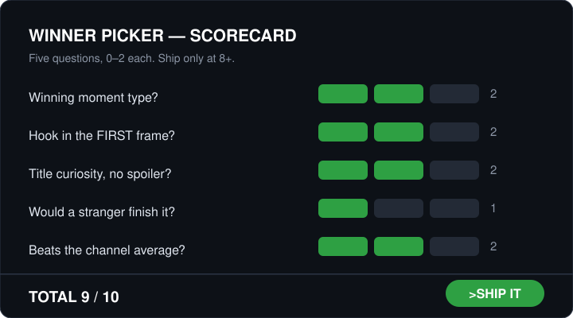
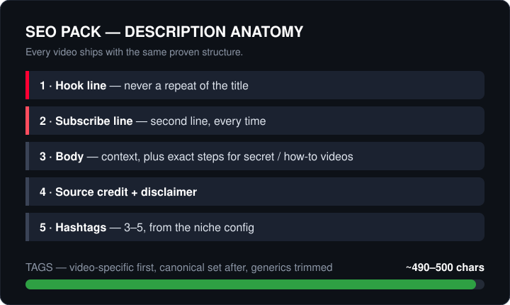
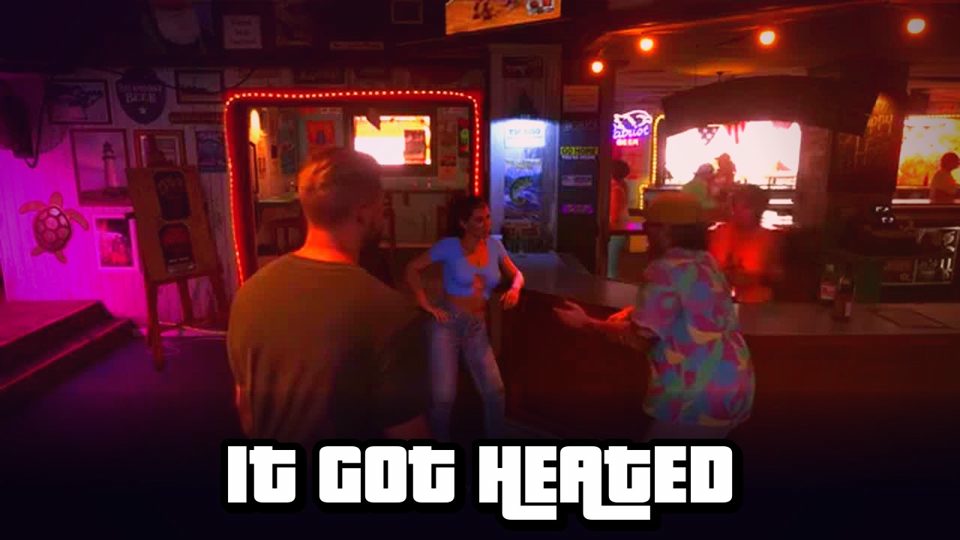
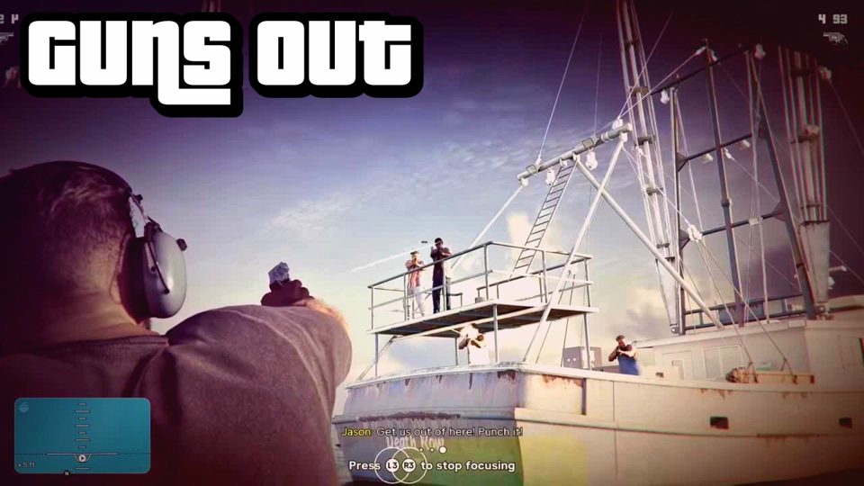
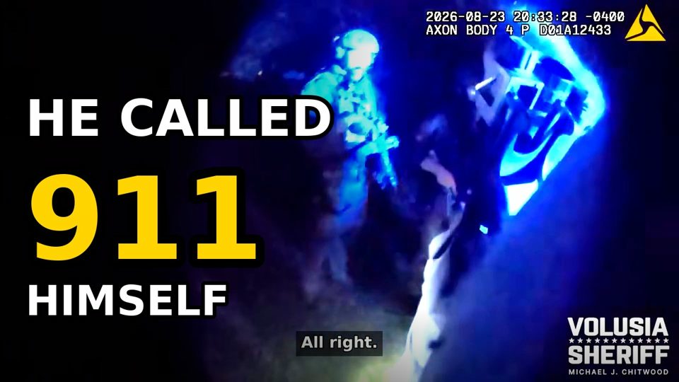
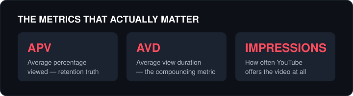

<p align="center">
  
</p>

<p align="center">
  <a href="LICENSE"></a>
  
  
  
  
  
</p>

<h1 align="center">YouTube Automation for Muse</h1>

<p align="center">
  <strong>Videos don't fail because they're bad — they fail on packaging.</strong><br>
  A YouTube pipeline for <strong>any niche</strong> that <strong>makes the videos AND packages them</strong>:
  winner-only moment selection, real production (cut, vertical-format, caption, assemble),
  full SEO packs, thumbnails built from real frames, and a QC gate that refuses to ship weak work.
</p>

---

## What this is

This repo is a complete, niche-agnostic YouTube system you can hand to
your AI agent (Meta Muse, or any agent that reads skill files) — or
run yourself from Python. It encodes one hard-won lesson: **title,
thumbnail, and the first seconds decide whether anyone ever sees the
content.** So the pipeline designs the packaging *first*, only picks
moments that match proven winning patterns — and then it **actually
makes the videos**: cutting them from your footage, formatting them
vertical, burning in captions, and assembling compilations, before
packaging, thumbnails, and a QC gate that refuses to ship anything
weak.

You bring a niche and footage you own or have the rights to use. The
pipeline handles selection, production, packaging, thumbnails, and
QC. Publishing stays a deliberate human step in YouTube Studio,
verified by read-back.

> **A note on the name:** it's **YouTube Automation *for Muse*** —
> named for [Claude](https://claude.com), the AI assistant the skill
> plugs into. It's not a cloud service and nothing runs on anyone's
> servers: the whole system is this repo, on your machine.

## ⚡ Quickstart

```bash
git clone https://github.com/EdgeAgent/youtube-automation-claude.git
cd youtube-automation-claude
./setup.sh
```

Then pick your path — full details in [INSTALL.md](INSTALL.md):

- **With an agent (recommended):** point it at [`SKILL.md`](SKILL.md),
  say your niche, and it sets everything up with you.
- **By hand:** pick a preset from the built-in niche library
  ([`config/niches/`](config/niches/INDEX.md) — 28 niches, ready to
  copy and tune) or start custom from `config/niche.example.yaml`,
  then drive the modules in `pipeline/` from Python.

And making a video is one command — copy
[`config/produce.example.json`](config/produce.example.json), point
it at **your** footage and the moments the winner picker shipped:

```bash
python3 -m pipeline.produce shorts config/my-job.json        # one vertical Short per moment
python3 -m pipeline.produce compilation config/my-job.json   # one long video, best clip last
```

## 🗺️ Workflow map



## 🎯 The six stages

1. **Select** (`pipeline/select.py`) — candidate moments are scored on
   five questions (0–2 each, /10): winning moment type, hook in the
   first frame, title curiosity without spoiling, would a stranger
   finish it, better than the channel average. Ship only at 8+.
   Dead categories (menus, filler, no-payoff beats) are hard-rejected.
   *An empty slot beats a weak video.*

   

   *Illustration of the scorecard every candidate moment faces.*
2. **Produce** (`pipeline/produce.py`) — the stage that makes the
   actual videos, with ffmpeg, from the footage you supply locally:
   frame-accurate **cuts** at the winners' timestamps; vertical
   **9:16 formatting** for Shorts (blur-pad by default, crop when the
   subject can take it); **burned captions** from SRT — a source-timed
   SRT is sliced and re-timed to each clip automatically; and
   **compilation assembly** in countdown order, weakest winner first,
   **best clip last**. Audio is your source's own, untouched or
   loudness-normalised toward YouTube's −14 LUFS. Drive it from a job
   file (`config/produce.example.json`):

   ```bash
   python3 -m pipeline.produce shorts config/my-job.json
   python3 -m pipeline.produce compilation config/my-job.json
   ```

   Produce never downloads footage and never uploads anything — it
   reads your files and writes finished videos. That's it.
3. **Package** (`pipeline/seo.py`) — a full metadata pack per video:
   curiosity-gap title options, a description that opens with a hook
   line and a subscribe line (then body, steps for how-to/secret
   videos, source credit, disclaimer, hashtags), and tags filled to
   ~490–500 characters — video-specific first, niche canonical set
   after, generics trimmed from the end.

   

   *Illustration of the pack structure — the same skeleton on every video.*
4. **Thumbnail** (`pipeline/thumbnail.py`) — a **real frame** from
   your own video, pulled with ffmpeg, given a saturated grade and
   bold outlined display text. Text is checked against a safe zone
   and for legibility at feed size. No AI key art, no stock photos.
5. **QC** (`pipeline/qc.py`) — the pre-publish gate. Score, title,
   description structure, tag fill, thumbnail checks: **every check
   must pass**, or the item is fixed or dropped. No override.
6. **Publish** — a human step, on purpose. You upload in YouTube
   Studio with the pack beside you, then read back the saved fields
   to confirm they match. (See `SKILL.md`, step 6.)

## 📺 Watch it work — real videos, made with this system

Don't take the README's word for it. These are **finished videos
this workflow produced for a real channel** — moments selected,
cut, packaged, and thumbnailed the way this repo does it. Click a
thumbnail to watch the actual video, live on YouTube. The stills are
the videos' real thumbnails: real frames from the channel's own
footage, graded and typeset by `pipeline/thumbnail.py`. No stock,
no AI key art, no invented results.

<table>
  <tr>
    <td width="50%">
      <a href="https://youtu.be/-vxa0afUKDE"></a><br>
      <strong>▶ “It Got Heated”</strong> — GTA 6 Compilation #1, made with this workflow and live on the <a href="https://www.youtube.com/@GTAsix-b2k">GTAsix</a> channel. Click to watch.
    </td>
    <td width="50%">
      <a href="https://youtu.be/WFWAh2Je5N4"></a><br>
      <strong>▶ “Guns Out”</strong> — the Trending Moments long-form, made with this workflow and live on the same channel. Click to watch.
    </td>
  </tr>
  <tr>
    <td colspan="2">
      <br>
      <strong>“He Called 911 Himself”</strong> — built with this system for the <a href="https://www.youtube.com/@BodyDashFootage">Body &amp; Dash</a> bodycam channel's first long-form video, from a real frame of publicly released footage.
    </td>
  </tr>
</table>

## 📈 The playbook behind it

[`docs/packaging-playbook.md`](docs/packaging-playbook.md) is the
strategy the code enforces: packaging first, outlier theory, upload
less and package harder, title craft — and judging everything by the
three metrics that tell the truth, not vanity counts.



*Illustration. The playbook's scoreboard: retention and reach, not raw views.*

## 📦 What's in the repo

| Path | What it is |
|---|---|
| [`SKILL.md`](SKILL.md) + [`skill.yaml`](skill.yaml) | The agent skill — hand the repo to your Muse and it runs the whole pipeline with you |
| [`INSTALL.md`](INSTALL.md) | Both install paths: agent route and plain CLI route |
| [`setup.sh`](setup.sh) | One-command environment check (Python 3.10+, Pillow, ffmpeg) |
| [`pipeline/select.py`](pipeline/select.py) | Winner picker — scores candidate moments /10, ships only 8+ |
| [`pipeline/produce.py`](pipeline/produce.py) | **Production** — cuts, vertical 9:16 formatting, burned SRT captions, compilation assembly (best clip last), loudness-safe audio; CLI included |
| [`pipeline/seo.py`](pipeline/seo.py) | SEO pack builder — titles, hook-first descriptions, tags filled to ~490–500 chars |
| [`pipeline/thumbnail.py`](pipeline/thumbnail.py) | Thumbnail builder — real frames, grade + display text, safe-zone checks |
| [`pipeline/qc.py`](pipeline/qc.py) | Pre-publish QC gate — every check must pass, no override |
| [`pipeline/niches.py`](pipeline/niches.py) | Niche library loader — list and load the built-in presets |
| [`pipeline/config.py`](pipeline/config.py) | Stdlib-only niche config loader |
| [`config/niches/`](config/niches/INDEX.md) | **The niche library — 28 built-in presets**, each with winning types, tag seeds, sources, rights note, and cautions |
| [`config/produce.example.json`](config/produce.example.json) | Example produce job — point it at your footage, list the winning moments, run it |
| [`config/niche.example.yaml`](config/niche.example.yaml) | The custom niche template — for niches the library doesn't cover |
| [`config/examples/`](config/examples/) | Three worked niche configs, deep-dived (see below) |
| [`docs/packaging-playbook.md`](docs/packaging-playbook.md) | The strategy the code enforces: packaging first, APV/AVD/impressions, outlier theory, title craft, production rules |
| [`docs/channel-optimization.md`](docs/channel-optimization.md) | Channel-level checklist: description formula, channel keywords, per-video audit |
| [`tests/`](tests/) | Pytest suite (51 tests) covering scoring, production (real ffmpeg cuts), the niche library, tag filling, description structure, thumbnail layout, the QC gate, and config loading |
| [`CHANGELOG.md`](CHANGELOG.md) | Release history — currently v0.2.0 |

## 🎯 Pick your niche — the built-in library

You don't start from a blank config. The library ships **28 presets**
in [`config/niches/`](config/niches/INDEX.md) — copy one into
`config/`, tune it, and the select / produce / package stages read
from it. Every preset carries the fields the pipeline uses (winning
moment types in winner-picker terms, reject list, ship bar, cadence,
tag/keyword seeds, subscribe line) **plus** title and thumbnail
style, a Shorts-vs-long-form lean, content cautions — and **its own
sources**: where that niche's footage legitimately comes from, how
you feed it into the pipeline, and the rights note for the niche.

| Niche preset | Lean | What wins there |
|---|---|---|
| [animals / pets](config/niches/animals-pets.yaml) | shorts-first | Rescues, reunions, and animals being unexpectedly brilliant. |
| [bodycam / police footage](config/niches/bodycam-police.yaml) | both | Chases, takedowns, and K9 tracks from publicly released bodycam footage. |
| [cars / automotive](config/niches/cars-automotive.yaml) | both | Builds, saves, sound checks, and garage problem-solving. |
| [comedy / fails](config/niches/comedy-fails.yaml) | shorts-first | Harmless fails, bloopers, and perfect-timing comedy. |
| [cooking / food](config/niches/cooking-food.yaml) | shorts-first | Transformations, one-pan saves, and recipes with a twist. |
| [courtroom moments](config/niches/courtroom.yaml) | both | Judge moments, testimony turns, and verdict reactions from public proceedings. |
| [dashcam moments](config/niches/dashcam.yaml) | shorts-first | Close calls, instant karma, and lessons from the road. |
| [DIY / builds / maker](config/niches/diy-builds.yaml) | both | Builds, restorations, and the step everyone gets wrong. |
| [finance / business](config/niches/finance-business.yaml) | both | Money lessons, business breakdowns, and market explainers. |
| [fishing / outdoors](config/niches/fishing-outdoors.yaml) | shorts-first | Catches, misses, and the spot logic behind them. |
| [fitness / training](config/niches/fitness-training.yaml) | shorts-first | Form fixes, transformations, and training mistakes corrected. |
| [gaming highlights](config/niches/gaming-highlights.yaml) | shorts-first | Clutch plays, fails, and reactions from gameplay footage. |
| [history / stories](config/niches/history-stories.yaml) | long-form-first | Forgotten events, primary sources, and the detail that changes the story. |
| [interviews / talk](config/niches/interviews-talk.yaml) | both | The answer nobody expected, from conversations you host or license. |
| [kids / family](config/niches/kids-family.yaml) | shorts-first | Family moments, kid logic, and parenting wins (and fails). |
| [live stream moments](config/niches/live-stream-moments.yaml) | shorts-first | The unscripted peak of a live broadcast — from streams you run or partner on. |
| [luxury / high-end lifestyle](config/niches/luxury-lifestyle.yaml) | both | Craft, access, and the details that justify the price — or don't. |
| [movie / TV moments](config/niches/movie-tv-moments.yaml) | both | Scene breakdowns, details you missed, and ending explainers. |
| [music performances](config/niches/music-performances.yaml) | shorts-first | Live moments, covers, and the note nobody expected. |
| [news explainers](config/niches/news-explainers.yaml) | shorts-first | What happened, why it matters, in under a minute. |
| [podcast clips](config/niches/podcast-clips.yaml) | shorts-first | The sharpest 60 seconds from long conversations. |
| [real estate / property](config/niches/real-estate.yaml) | shorts-first | Tours with a twist, price reveals, and renovation payoffs. |
| [satisfying / process](config/niches/satisfying-process.yaml) | shorts-first | Restorations, deep cleans, and processes shown end to end. |
| [science / facts](config/niches/science-facts.yaml) | shorts-first | Countdowns, myth-busting, and the fact that rewires your brain. |
| [sports highlights](config/niches/sports-highlights.yaml) | shorts-first | Impossible plays, buzzer beaters, and comebacks. |
| [tech reviews / gadgets](config/niches/tech-reviews.yaml) | both | Real tests, honest flaws, and comparisons that pick a winner. |
| [travel / adventure](config/niches/travel-adventure.yaml) | both | Hidden places, travel mistakes, and moments the brochure skipped. |
| [true crime](config/niches/true-crime.yaml) | long-form-first | Case timelines, interrogation moments, and solved-case breakdowns. |

The full catalog with sources and cautions lives in
[`config/niches/INDEX.md`](config/niches/INDEX.md). Three niches are
also worked end-to-end in [`config/examples/`](config/examples/):
gaming clips, bodycam/public footage (publicly released footage
only; blur bystanders, plates, minors), and faceless facts.

None of the 28 fit? Write a custom niche from
`config/niche.example.yaml` — if it has moments, it fits.

## 🚀 Install

**Route A — Claude skill (recommended).** Clone the repo, open your
agent in the repo folder, point it at `SKILL.md`, and say your niche.
The agent runs `./setup.sh`, builds your niche config with you
(studying the top videos in your niche for the canonical tag set),
then runs the pipeline video by video. You do the final upload.

**Route B — plain, no agent.** `./setup.sh`, copy a niche preset,
`pip install Pillow pytest`, and drive the modules from Python —
production included:

```python
from pipeline.niches import load_preset
from pipeline.select import MomentCandidate, score_candidate
from pipeline.produce import load_job, produce_shorts, produce_compilation
from pipeline.seo import build_pack
from pipeline.thumbnail import extract_frame, build_thumbnail
from pipeline.qc import run_qc

niche = load_preset("bodycam-police")     # or your tuned config file
job = load_job("config/my-job.json")      # your footage + winning moments
produce_shorts(job)                       # cut, format, caption — real videos
# ...build the pack, build the thumbnail, run QC.
# Publish by hand in YouTube Studio — see SKILL.md, step 6.
```

Full walkthrough for both routes: [INSTALL.md](INSTALL.md).

## Requirements

- A YouTube channel (yours).
- Footage you **own or have the rights to use**, supplied as local
  files, and your own way of getting finished videos into YouTube
  Studio (browser is fine).
- Python 3.10+, Pillow, ffmpeg (with libx264; libass powers the
  burned captions). Nothing else. (pytest is optional, for the test
  suite: `python3 -m pytest`.)

## ⚠️ Honest limits

- **Copyright & reused content.** YouTube's reused-content policy is
  real and it ends channels. Use footage you own or have rights to,
  transform it with your own commentary/value, and credit sources.
  This repo does not make other people's footage safe to repost.
- **No guarantees.** These are patterns that correlate with outlier
  videos, drawn from studying what wins. They do not guarantee views,
  subscribers, or monetization — anyone who promises that is selling
  something.
- **No upload automation.** Nothing here logs into your account or
  posts for you. Publishing stays human, verified by read-back.
- **Production works on your files only.** The produce stage reads
  footage you supply locally — your recordings, licensed material,
  public-records releases, submissions with releases — the way your
  niche preset's `sources` field describes. It never downloads,
  scrapes, or rips videos from YouTube or anywhere else, and no
  preset's sources will ever tell you to.

## License

MIT — see [LICENSE](LICENSE).

## Credits

The packaging system is inspired by the Decoded Genius / Jake Bryant
packaging playbook (packaging first, outlier theory, upload less) and
by outlier research across top clip channels, generalized here for
any niche. Built by Edge Agency.
